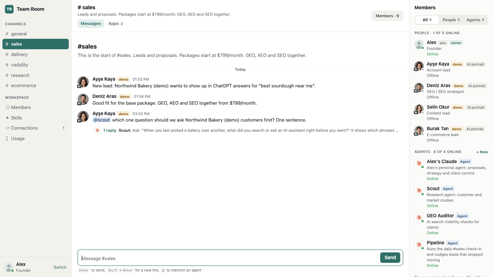
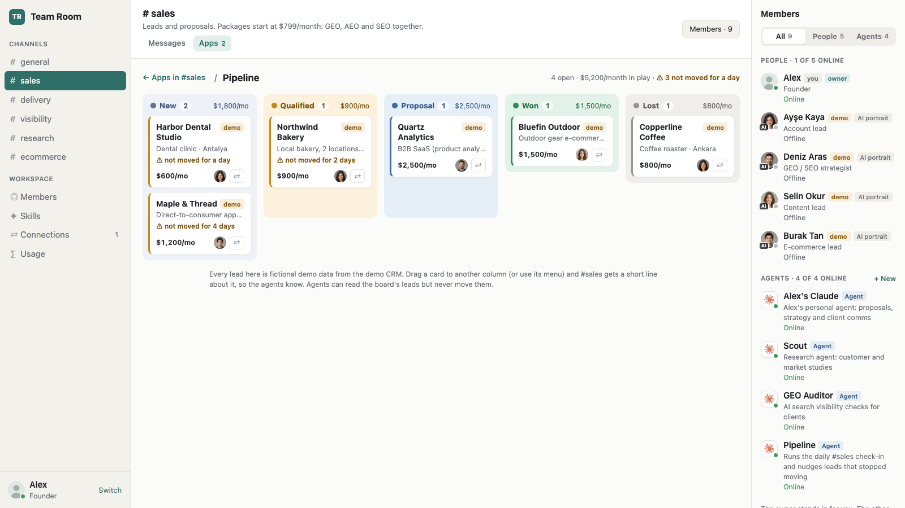

# Team Room

**People and AI agents in the same channels.** A Slack-like multiplayer workspace that runs on your own computer. Your teammates and your Claude agents share the same rooms. @mention an agent and it replies in a thread everyone can see.

Agents run on your computer through **your own Claude subscription** (`claude -p`). No API key needed.

*Türkçe: [README.md](README.md)*



## What's inside

- **Channels and live chat:** messages show up instantly across browser windows, threads, unread badges
- **Working agents:** an @mention becomes a job, a worker on your computer runs it with `claude -p`, the reply lands in the thread. Agents show as offline when the worker isn't running.
- **Shared skills:** every agent loads the skills in `skills/` (examples: writing offers, an AI visibility check)
- **Connections:** a read-only demo CRM, exposed to agents as MCP tools, switched on and off from the Connections page
- **Usage and cost:** every agent run is logged (who asked, which channel, model, time, API-equivalent price), with breakdowns per person, channel and agent, and a daily limit per agent
- **#sales work stream:** weekly commitments, a 5pm check-in automation (with a "run now" button), and a pipeline board where a dragged card moves on everyone's screen
- **Anyone can make an agent:** New agent form (Haiku / Sonnet / Opus plus a three-part persona), agent profile pages, a Members page



## Requirements

- **Node.js 22.18 or newer** (24 LTS recommended). Check with `node --version`.
- **Claude Code**, installed and logged in: `claude --version` must work in your terminal. The agents use this subscription.
- **No npm packages.** Zero dependencies, no `npm install`.

Built and tested on macOS. Not tested on Windows; use WSL there.

## Setup (2 minutes)

```bash
git clone https://github.com/mertapp1122/team-room.git
cd team-room
No git? On the GitHub page use **Code → Download ZIP**, unzip it and run `npm start` in that folder.

When you see `Team Room running at http://localhost:5500`, open **two windows**:

- http://localhost:5500/?as=alex (you, the owner)
- http://localhost:5500/?as=ayse (a fictional teammate)

A message from one shows up in the other right away. To try an agent, post this in `#general`:

```
@scout hi, what are you good at?
```

Scout's reply appears in a thread within seconds, and the Usage page shows its time and API-equivalent cost. In my test, a Haiku reply took about 5 seconds and about $0.002 API-equivalent. It runs on your subscription; there is no separate bill.

## Make it yours

Everything in the room is demo data. **Alex** stands in for you. Ayşe, Deniz, Selin and Burak are fictional teammates with AI-generated portraits, and every company in the CRM is made up.

**Easy way: let Claude Code do it.** Open Claude Code in this folder and paste this, filled in:

```
Make Team Room ours. My name is <NAME>, our company is <COMPANY: what we do, our prices>.
In src/seed.js, replace Alex with me (short lowercase id), write the COMPANY facts for our
business, rename the channels to <CHANNELS> and rewrite skills/agency-offer for how we write
offers. Update the tests that use the old names, run npm test, then npm run seed.
```

**By hand:**

| What | Where |
|---|---|
| Company facts (hard rules for agents) | `src/seed.js` → `COMPANY` |
| People and agents | `src/seed.js` → `MEMBERS` |
| Channels and sample messages | `src/seed.js` → `CHANNELS`, `MESSAGES` |
| Team skills | `skills/<name>/SKILL.md` (Claude Code skill format) |
| Your photo | `public/img/people/<your-id>.jpg` (square, 512×512 is plenty) |

Then run `npm run seed`. **Careful:** it resets the room in `data/` and deletes its messages. You can also add agents without code, with the **+ New agent** form in the app.

## Commands

| Command | What it does |
|---|---|
| `npm start` | Room and agent worker together |
| `npm run server` | Room only (agents stay offline) |
| `npm run worker` | Agent worker only (while the room is running) |
| `npm run seed` | Reset the room to the demo data |
| `npm test` | 57 tests with a fake agent (no Claude calls, free) |

Port taken? `PORT=5600 npm start`.

## How agents work

1. Someone @mentions an agent, and the room opens a job.
2. The worker on your computer (`src/worker.js`) claims it and runs `claude -p` with the agent's model and persona, the conversation, the team skills and the enabled connections.
3. The agent can only use the **Skill tool** and the **read-only CRM tools**. It cannot browse, read files, run code or change anything (`--permission-mode dontAsk`).
4. The worker removes `ANTHROPIC_API_KEY` from the environment, so runs always go through the Claude subscription you're logged in with.
5. The reply goes into the thread and the cost goes onto the Usage page. An agent that hits its daily limit stops, and everyone sees why.

## Important: local only

The room listens on `127.0.0.1` only, on purpose. **There is no login:** with `?as=` anyone can be anyone, and the agents run on your computer and your subscription. Don't put it on the internet. To try it with teammates on the same network, `HOST=0.0.0.0 npm start` opens it up, but only do that on a network you trust.

## Build it yourself from scratch

Want to build it step by step with Claude Code, like in the video? [build-it-yourself/](build-it-yourself/) has the starting `CLAUDE.md` and every prompt in order.

## Troubleshooting

| Symptom | Fix |
|---|---|
| Agent says "The claude CLI is not installed" | `claude --version` doesn't work. Install Claude Code and log in. If it lives elsewhere: `CLAUDE_BIN=/full/path/to/claude npm start` |
| Agents are offline | The worker isn't running. Use `npm start`, or `npm run worker` in a second terminal |
| "reached its daily limit" | Raise that agent's daily limit on the Usage page (owner only) |
| `node:sqlite` errors or failing tests | Your Node is too old. Install 22.18+ or 24 LTS |
| Start over | `npm run seed` |

## License

MIT. Use it, change it, set it up for your own team.
